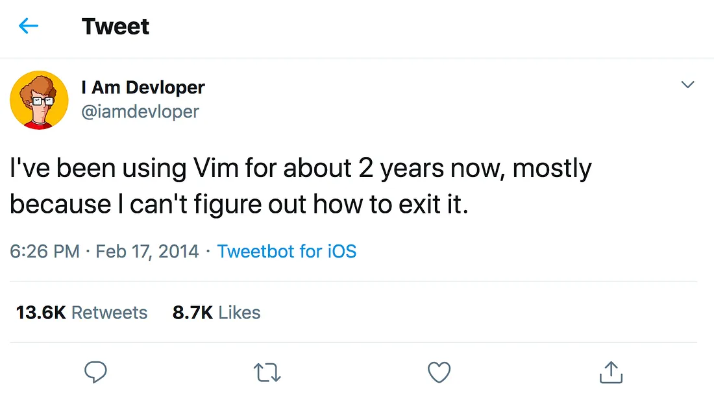

Core Command
===

# Goal of this lecture

- Learn the basic Linux command-line tools
- Understand what they do and when to use them
- Practice with useful flags

# Why?

- Mastering the CLI -> faster, more precise, automatable workflows
- Essential for sysadmin, security, development work (and the upcoming semesters)

<!-- end_slide -->

The Linux PATH
===

`PATH` is a special **environment variable** (we will learn more about them later)

- It contains a list of directories separated by colons (`:`)
- When you execute a command, the `SHELL` searches these directories in order until it finds a matching executable
  - The first binary that matches is executed
  - Directories coming first have higher precedence

<!-- pause -->

Example `PATH`:

```bash
/usr/local/bin:/usr/bin:/usr/local/sbin:/usr/sbin
```

<!-- end_slide -->

Executing a command
===

Running a command can be as simple as executing `mycmd`

- If `mycmd` is found in the `PATH` (e.g. `/bin/mycmd`) it is executed
- Each command can be invoked with positional arguments, e.g. `mycmd arg1 arg2`

<!-- pause -->

- There are also additional flags that are not positional (mostly)
  - There can be short and long variants of the same flag
    - `mycmd -h`, `mycmd --help`
  - Typically, flags `-a`, `-b` can be combined to `-ab`

<!-- pause -->

- Of course, there are exceptions...

<!-- end_slide -->

Example in C
===

Let's build our own executable and run it as `/tmp/mycmd arg1 arg2`

```c +exec:mycmd
#include <stdio.h>
int main(int argc, char *argv[]) {
    for (int i = 0; i < argc; i++) {
        printf("%d: %s\n", i, argv[i]);
    }
}
```

<!-- pause -->

For flags, use libraries like `getopt` (or something more modern)

<!-- end_slide -->

Working with paths
===

Don't confuse absolute and relative paths!

- `/bin`: Is the global bin folder
- `bin`: The `bin` folder relative your current directory (e.g. `/home/user`)

Paths are case-sensitive

- `foobar` and `FooBar` are different files that can co-exist

<!-- pause -->

`~` is a shortcut for your home directory

- `~/Downloads` instead of `/home/user/Downloads`

<!-- pause -->

`.` refers to your current directory

- `./foobar` == `foobar` == `././foobar`

<!-- pause -->

`..` refers to your parent directory

- From `/home/user`: `..` == `/home`, `../..` == `/`

<!-- pause -->

Files starting with `.` are hidden by default

- e.g. config files: `~/.config`
- Don't confuse `./config` with `.config` or `~/.config`

<!-- end_slide -->

Getting started
===

| Command | Description                                 | Useful Flags / Examples                         |
| ------- | ------------------------------------------- | ----------------------------------------------- |
| `pwd`   | **P**rint current **w**orking **d**irectory |                                                 |
| `ls`    | **L**i**s**t directory contents             | `-l` **l**ong format, `-a` show **a**ll files,  |
|         |                                             | `-sh` **s**ize (**h**uman-readable) of files    |
| `cd`    | **C**hange **d**irectory                    | `cd -` go back to previous directory            |
|         |                                             | `cd` without parameters goes back to home       |
| `tree`  | Show directory structure                    | `-L 2` **l**imit depth, `-a` show **a**ll files |
| `echo`  | Print given arguments or variables          | `echo $PATH`, `echo -n text without newline`    |
| `clear` | Clear the current terminal screen           | Similar to `Ctrl+l` which scrolls to new screen |
| `which` | Show full path of command                   | `-a` shows **a**ll matches                      |

<!-- pause -->

> `ranger`, `lf`, `mc`, `yazi` are terminal file managers

<!-- end_slide -->

File Manipulation
===

| Command | Description                          | Useful Flags / Examples                                  |
| ------- | ------------------------------------ | -------------------------------------------------------- |
| `cp`    | **C**o**p**y files/directories       | `-r` **r**ecursive,                                      |
|         |                                      | `-i` **i**nteractive (confirm overwrite)                 |
| `mv`    | **M**o**v**e/rename files            | `-i` **i**nteractive (confirm overwrite)                 |
| `rm`    | **R**e**m**ove files                 | `-r` **r**ecursive, `-i` **i**nteractive, `-f` **f**orce |
| `rmdir`  | **R**e**m**ove empty **dir**ectories | `-p` remove empty **p**arent dirs                        |
| `mkdir` | Create (**m**a**k**e) **dir**ectory  | `-p` create **p**arent dirs if missing                   |
| `touch` | Create empty file / update timestamp | `-d` specify a custom **d**ate                           |
| `shred` | Override a file to hide its contents | `-u` removes the file after shredding                    |

<!-- pause -->

> `rm` does not use a trash can. If you remove something, it's gone

> ⚠️ **Danger Zone:** `rm -rf /` will erase **everything** - don't run this!

<!-- end_slide -->

Viewing Files
===

| Command | Description                      | Useful Flags / Examples                             |
| ------- | -------------------------------- | --------------------------------------------------- |
| `cat`   | Show file contents               | `cat file.txt`                                      |
| `tac`   | Reverse `cat`                    | `tac file.txt`                                      |
| `less`  | View file page by page           | `/text` search forward, `?text` search backward     |
| `more`  | More primitive pager than `less` |                                                     |
| `head`  | Show first lines of file         | `-n 20` show first 20 lines                         |
| `tail`  | Show last lines of file          | `-f` **f**ollow file (useful for logs)              |
| `wc`    | Count lines, words, or bytes     | `-l` **l**ines, `-w` **w**ords, `-c` **c**haracters |

<!-- pause -->

Instead of `cd foo`, `cd bar`, `cat linux.txt` simply `cat foo/bar/linux.txt`

<!-- end_slide -->

Editing Files
===

# Basics

- When working on the CLI, you also need a text-based editor
- Today, `nano` and `vim` are the most common editors
- `nano` is a bit simpler and shows the required keyboard shortcuts
  - `^` is the `Ctrl` key

<!--pause-->

- `vim` is more advanced and allows faster editing, but is more complex!
  - Command driven editor with different modes
  - `i` for insert mode, `v` for visual mode
  - `:` for command mode, `Esc` to go back to regular mode
  - From insert mode: `Esc`, `:wq` to **w**rite and **q**uit
  - From regular mode: Use `/` to search (like in less)

<!-- end_slide -->

Editing Files
===



<!--pause-->

# Advanced

- Nowadays, there are more modern editors that support the Language Server Protocol (LSP)
  - If you want a really advanced text editor, have a look at `helix` or `neovim`

<!-- end_slide -->

Improve Your Workflow
===

| Command   | Description                         | Useful Flags / Examples |
| --------- | ----------------------------------- | ----------------------- |
| `history` | Show command history                | `!42` rerun command #42 |
| `!!`      | Run the same command again          |                         |
| key: `↑`  | Select last commands                |                         |
| key: `⇥`  | Autocomplete command/directory/file | note: case-sensitive    |
| key: `^r` | Reverse Search                      |                         |

> `^r` is the terminal notation for Ctrl+r

<!--pause -->

In `bash` your history is not shared across sessions.

Your history is persisted in `~/.bash_history`.

<!-- pause -->

______________________________________________________________________

`HISTSIZE`: maximum number of commands kept in the current shell session's history.

`HISTFILESIZE`: maximum number of lines stored in `~/.bash_history`.

<!-- end_slide -->

Thank you!
===

Thank you for your attention!

Don't forget the feedback in Moodle please!
